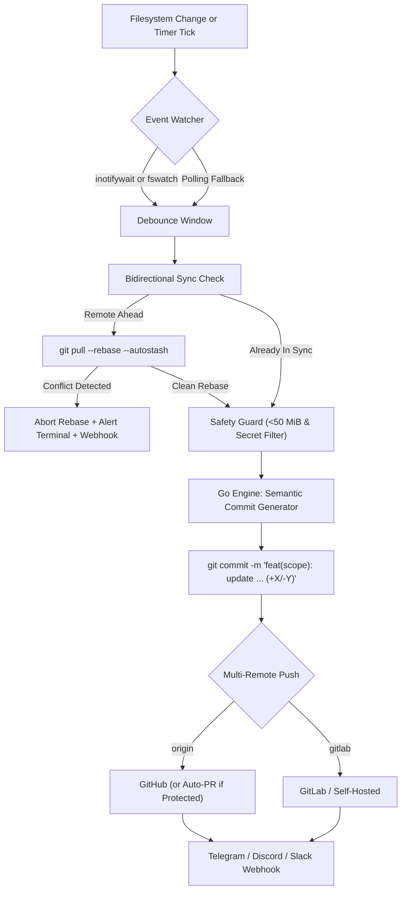

<div align="center">


# Syncalibur

**Autonomous Git Auto Commit & Auto Pusher Daemon • Multi-Remote Git Sync Engine, Organic Commit Gainer & Live TUI Cockpit**

[](https://github.com/YusufKaya00/Syncalibur/actions)
[](#cli-command-reference)
[](#architecture--sync-pipeline)
[](#what-is-syncalibur)
[](CONTRIBUTING.md)

*Forge-grade **Git auto-commit**, **auto-pusher**, and **organic commit gainer** for your repositories — powered by a compiled Go core (`syncalibur`), Semantic Conventional Commit generation, concurrent Multi-Repo Fleet orchestration, Telegram & Multi-Channel Webhooks, and an Interactive Live TUI Cockpit.*

</div>

---

## Terminal Preview (`syncalibur status`)

When you run `syncalibur status` (or `syncalibur logs`), the native Go engine renders [`assets/syncalibur-logo.png`](assets/syncalibur-logo.png) directly inside your terminal using **24-bit TrueColor ANSI escape sequences** alongside live repository telemetry, verified accounts, active operating mode, and a 7-day commit velocity sparkline:

<div align="center">
  
</div>

---

## One-Liner Quick Install

Anyone can install Syncalibur globally in seconds:

```bash
curl -fsSL https://raw.githubusercontent.com/YusufKaya00/Syncalibur/main/install.sh | bash
```

Or clone manually and watch any local repository:

```bash
git clone https://github.com/YusufKaya00/Syncalibur.git ~/Syncalibur
cd ~/Syncalibur
./syncalibur.sh install /path/to/your/repo
```

Once installed, the global `syncalibur` command is automatically linked into `~/.local/bin/syncalibur` so you can run `syncalibur status`, `syncalibur mode`, `syncalibur fleet`, `syncalibur notify`, or `syncalibur doctor` from any directory.

---

## What is Syncalibur?

### 1. AST Git Intelligence, Conventional Commits & Multi-Language Support
- **Compiled Go Core (`cmd/syncalibur-engine/main.go`):** Zero external Go dependencies (100% Go standard library). Automatically compiled into `bin/syncalibur` on first run or after any self-update.
- **AST & Function-Aware Conventional Commit Engine:** Goes far beyond file-level messages (`auto: update file.js`). The Go engine inspects Go AST nodes (`ast.FuncDecl`, `ast.TypeSpec`) and Unified Diff Hunks across React (`export const Header = () => ...`), TypeScript, JavaScript, Java, Python, Rust, and C++ to generate pinpoint Conventional Commits:
  - `feat(Header): update Header() (+15/-2)`
  - `feat(main): update detectSecretsInFile() (+1/-1)`
  - `feat(Payment): update processTransaction() (+20/-4)`
  - `docs(README): update README.md (+85/-12)`
  - Optional local **Ollama AI Commit Hook** (`SYNCALIBUR_AI_COMMIT="true"`) with a strict 2-second non-blocking timeout and automatic heuristic fallback.
- **Zero-Friction Commit Protection (Syntax Hold & Secret Shield):**
  - **Syntax Hold:** Pre-flight gate that holds back commits if code has broken syntax (open braces, unclosed string/template literals, half-written statements) until you finish typing. Combines native compilers (`go/parser`, `py_compile`, `node --check`, `bash -n`, `tsc`, `javac`) with a native **Universal Lexical Balance Engine** supporting Go, Python, React (JSX/TSX), TypeScript, Node.js, Java, Bash, YAML, C/C++, Rust, and PHP.
  - **Secret Shield & Shannon Entropy Quarantine:** Detects credentials via signatures (AWS, GitHub PAT, OpenAI `sk-...`, Slack, Private Keys) and mathematical Shannon Entropy ($H \ge 4.4$ bit/char). Quarantines sensitive files into `git add` exclude patterns without blocking other safe files.
- **Safe Bidirectional Sync (`--rebase --autostash`):** Periodically fetches from your primary remote (`origin`), detects when remote commits are ahead of local `HEAD`, and safely runs `git pull --rebase --autostash` when the working tree is clean. If a merge conflict is detected, Syncalibur **immediately aborts the rebase** (`git rebase --abort`), leaves your working tree untouched, and pops open a diagnostic terminal window.
- **Protected Branch Auto-PR with Rich Template:** If a target branch (like `main`) is protected with required Pull Request reviews or force-push restrictions, Syncalibur automatically pushes a `sync/auto-*` branch and opens a Pull Request populated with a structured Markdown PR template (diff stats, component checkboxes, and verification checklist).
- **Organic Commit Cadence & Contribution Consistency:** Naturally turns your real day-to-day coding progress into steady, well-scoped semantic commits pushed on time across GitHub and GitLab — keeping your contribution graph consistently active with genuine code changes (never fake or empty commits).
- **Native Filesystem Event Watching (`inotifywait` / `fswatch`):** Zero-CPU event-driven watching when `inotifywait` (Linux) or `fswatch` (macOS) is installed, with automatic fallback to lightweight polling.
- **Multi-Repository Fleet Supervisor (`repos.list`):** Watch 5, 10, or 50 repositories simultaneously! Run `syncalibur fleet scan ~/projects` to auto-discover all Git repositories using concurrent Go goroutines and supervise them in parallel.

### 2. Two-Pane Live TUI Cockpit, Lucide Typography & Diagnostics
- **Native `syncalibur` Process Identity (`top` / `htop` / Activity Monitor / Task Manager):** Runs under its own compiled binary process name **`syncalibur`** across Linux, macOS, and Windows so you can inspect exact CPU (~0.0%) and RAM (~7 MB) usage directly in `top` or `syncalibur status`.
- **Interactive Two-Pane Live TUI Cockpit (`syncalibur ui`):** Full-screen, flicker-free terminal control center built in Go using raw terminal mode and alternate screen buffering. Split into two dedicated panes:
  - **Top Pane (Live Telemetry Cockpit):** Displays real-time daemon state, today's commit count, 7-day velocity sparkline (` ▂█▅··▅▃`), Syntax & Secret Shield status, and hotkey cheatsheet (updated live every second).
  - **Bottom Pane (Scrollable Live Log Viewport):** Dynamically sized viewport that reads `syncalibur.log` with full keyboard scrolling (`↑/↓` or Vim `j/k`, `PageUp/PageDown`, `g` Top, `G` Bottom) and Follow mode toggle (`f`).
  - **Single-Keystroke Hotkeys:**
    - `[p]` Pause / Resume Auto-Sync
    - `[s]` Force Immediate Commit & Push
    - `[b]` Force Bidirectional Pull (`--rebase`)
    - `[f]` Toggle Live Log Follow Mode
    - `[↑/↓]` or `[j/k]` Scroll Log Viewport
    - `[d]` Run 11-Point System Doctor
    - `[q]` Quit TUI cleanly
- **Lucide Minimalist Typography:** All terminal outputs, emblems, banners, and diagnostic tables use sleek, standardized Lucide minimalist glyphs (`✓`, `✕`, `▲`, `⛨`, `✦`, `↗`, `↙`, `●`, `○`, `⇄`, `✚`, `◆`) instead of distracting colored emojis.
- **Telegram Bot & Multi-Channel Webhooks (`Telegram`, `Discord`, `Slack`, `Generic JSON`):** Configure `SYNCALIBUR_TELEGRAM_BOT_TOKEN` & `SYNCALIBUR_TELEGRAM_CHAT_ID` (or `SYNCALIBUR_WEBHOOK_URL`) in `syncalibur.env` to receive instant rich notifications on push failures, rebase conflicts, self-updates, or every sync, and test anytime with `syncalibur notify` (`syncalibur telegram-test`).
- **11-Point `syncalibur doctor` Diagnostic Suite:** Verifies Git identity, Go engine binary health, filesystem watcher availability, SSH connectivity (`github.com` / `gitlab.com`), `gh` / `glab` CLI authentication, OS background service registration, remote push permissions, and Syntax & Secret Shield verification.

---

## Architecture & Sync Pipeline



```text
  ┌────────────────────────────────────────────────────────────────────────────────────────┐
  │                       S Y N C A L I B U R   E X E C U T I O N   F L O W                │
  └────────────────────────────────────────────────────────────────────────────────────────┘

   [1] File Change Detected        ──► inotifywait / fswatch (0% CPU) or 3s Polling Fallback
            │
            ▼
   [2] Bidirectional Rebase Check  ──► Fetches remote; runs 'git pull --rebase --autostash'
            │                          (Auto-aborts & pops open Alert Terminal on conflict)
            ▼
   [3] Pre-Staging Safety Shield   ──► Universal Syntax Pre-flight & Shannon Entropy Secret Shield
            │                          (Go, Python, React JSX/TSX, TypeScript, Node, Java, Bash, YAML, C/C++, Rust)
            │                          (Holds broken syntax ticks & quarantines high-entropy secrets)
            ▼
   [4] Go Engine AST Commit        ──► Inspects AST/hunks -> "feat(Component): update myMethod() (+42/-7)"
            │
   [5] Multi-Remote Push & Alert   ──► Pushes to GitHub + GitLab -> Dispatches Telegram / Webhook
```

---

## CLI Command Reference

### Developer Push Ergonomics & Universal Safety

| Command | Description |
| :--- | :--- |
| `syncalibur push [MSG] [--tidy]` | **One-Shot Push:** Runs preflight syntax & secret check, generates AST conventional commit (or uses custom msg), pulls safely, and pushes immediately to all remotes (<1.5s) |
| `syncalibur commit [MSG]` | **Local Safe Commit:** Preflight checks & commit without network push (perfect for offline coding) |
| `syncalibur check` / `preflight` | **Pre-Push Inspection:** Inspects working tree, tests Syntax Hold & Secret Shield, shows proposed AST commit message, and prints sync matrix |
| `syncalibur tidy` | **History Hygiene (Smart Squash):** Squashes unpushed local micro-commits into a single clean AST-driven Conventional Commit with automatic rollback checkpoint (`refs/syncalibur/backup-HEAD-...`) |
| `syncalibur hook install` | **Universal Git Hook:** Installs `.git/hooks/pre-commit` (Secret Shield & Syntax Hold) and `.git/hooks/prepare-commit-msg` (AST suggestions) so standard `git commit` commands outside Syncalibur are guarded |
| `syncalibur hook status` / `uninstall` | Check active Git hook status or uninstall Syncalibur Git hooks cleanly |

### Autonomous Daemon & Fleet Cockpit

| Command | Description |
| :--- | :--- |
| `syncalibur ui` | Launch the **Interactive Two-Pane Live TUI Cockpit** (Live Top Telemetry + Scrollable Bottom Viewport with `[↑/↓]`, `[j/k]`, `[PageUp/Down]`, `[f]` Follow, `[p]` Pause, `[s]` Sync, `[b]` Pull, `[d]` Doctor, `[q]` Quit) |
| `syncalibur install [PATH]` | Auto-detect repo, create missing remote repo if needed, link `~/.local/bin/syncalibur`, and start the OS service |
| `syncalibur status` | Render the TrueColor emblem, 7-day commit sparkline, remote matrix, and recent events |
| `syncalibur logs` | Render the emblem header and stream live color-coded log events (`tail -f`) |
| `syncalibur sync` | Trigger an immediate one-shot bidirectional pull, semantic commit, and multi-remote push |
| `syncalibur pull` | Trigger an immediate safe bidirectional pull (`git pull --rebase --autostash`) |
| `syncalibur pause` / `resume` | Temporarily pause or resume background auto-commits without uninstalling the service |
| `syncalibur notify [MSG]` | Send an instant test notification to your configured **Telegram Bot** (`syncalibur telegram-test`) and Webhook |
| `syncalibur doctor` | Run the 11-point diagnostic health check (Git, Go Engine, inotify, SSH, `gh`/`glab`, remotes, Syntax & Secret Shield) |
| `syncalibur fleet status` | Display a concurrent status table of all repositories in `repos.list` |
| `syncalibur fleet scan [DIR]` | Recursively scan a directory for Git repositories using Go goroutines and append them to `repos.list` |
| `syncalibur fleet start` | Spawn background Syncalibur daemons for every active repository in `repos.list` |
| `syncalibur fleet stop` | Stop all background fleet daemons |
| `syncalibur alert` | Test the graphical pop-up diagnostic terminal window on your desktop environment |
| `syncalibur uninstall` | Stop the background daemon and remove OS startup registration |

---

## Configuration (`syncalibur.env.example` → `syncalibur.env`)

Your personal `syncalibur.env` and `repos.list` files are **gitignored** so your local paths and webhook tokens are never pushed to GitHub. To customize settings, copy the template:

```bash
cp syncalibur.env.example syncalibur.env
```

```dotenv
# Target Git repository path to watch and auto-sync
SYNCALIBUR_REPO_DIR="/path/to/your/git/repository"

# Push target strategy:
#   "all"    -> Push to ALL configured git remotes (e.g., GitHub + GitLab simultaneously)
#   "origin" -> Push only to origin
SYNCALIBUR_REMOTE="all"

# Commit message style:
#   "semantic" -> Go Engine generates Conventional Commits: feat(scope): update X (+12/-3)
#   "simple"   -> Classic timestamped auto: file1, file2 (YYYY-MM-DD HH:MM:SS)
SYNCALIBUR_COMMIT_STYLE="semantic"

# Optional Local AI Commit Message Generation via Ollama (true / false)
SYNCALIBUR_AI_COMMIT="false"
SYNCALIBUR_OLLAMA_MODEL="qwen2.5-coder:1.5b"

# Safe Bidirectional Sync (auto-pull --rebase --autostash before pushing)
SYNCALIBUR_BIDIRECTIONAL="true"
SYNCALIBUR_PULL_INTERVAL="60"

# Native Filesystem Event Watching (inotifywait / fswatch with polling fallback)
SYNCALIBUR_USE_FS_EVENTS="true"

# Multi-Channel Webhooks (Discord, Slack, Telegram, or Generic JSON)
SYNCALIBUR_WEBHOOK_URL=""
SYNCALIBUR_WEBHOOK_ON_SUCCESS="false"
SYNCALIBUR_TELEGRAM_BOT_TOKEN=""
SYNCALIBUR_TELEGRAM_CHAT_ID=""
```

---

## Telegram Bot & Multi-Channel Webhook Alerts

Syncalibur's Go engine includes a native multi-channel notification dispatcher supporting **Telegram Bot API**, **Discord Embeds**, **Slack Blocks**, and **Generic JSON Webhooks**.

### 1. Configure Telegram Bot Alerts
1. Message [@BotFather](https://t.me/BotFather) on Telegram and run `/newbot` to get your bot token.
2. Obtain your chat or channel ID (for example via `@userinfobot` or `https://api.telegram.org/bot<TOKEN>/getUpdates`).
3. Add your credentials to `syncalibur.env`:

```dotenv
SYNCALIBUR_TELEGRAM_BOT_TOKEN="123456789:ABCdefGHIjklMNOpqrSTUvwxYZ"
SYNCALIBUR_TELEGRAM_CHAT_ID="987654321"
# Set to "true" if you also want notifications on every successful push (default: failures & conflicts only)
SYNCALIBUR_WEBHOOK_ON_SUCCESS="true"
```

### 2. Configure Discord or Slack Webhooks (Optional)
```dotenv
SYNCALIBUR_WEBHOOK_URL="https://discord.com/api/webhooks/..."
```

### 3. Test Your Notification Channel
Verify your Telegram Bot or Webhook configuration at any time from your terminal:

```bash
syncalibur notify "Hello from Syncalibur!"
# or
syncalibur telegram-test
```

---

## Multi-Repository Fleet Mode (`repos.list`)

Want to watch multiple projects at once? Use **Fleet Mode**:

```bash
# Automatically scan a workspace directory and add all Git repositories to repos.list
syncalibur fleet scan ~/workspace

# View real-time parallel status across all repositories in your fleet
syncalibur fleet status

# Start background sync daemons for every repository in repos.list
syncalibur fleet start
```

---

## Open-Source Governance & Pull Request Workflow

To protect all users running Syncalibur's autonomous self-updater, the `main` branch is protected with strict repository governance:
- **Force Pushes & Branch Deletion Disabled:** History on `main` cannot be overwritten.
- **Pull Request & 1 Approval Required:** Direct pushes to `main` from external contributors are blocked; all changes require a Pull Request and **at least 1 approving review** from `@YusufKaya00` (`CODEOWNERS`).
- **Automated CI Verification (`Syncalibur CI`):** Every PR automatically runs Bash syntax verification, `ShellCheck`, `go vet`, native `go build`, engine smoke tests, and secret hygiene checks before merging is allowed.
- **Automated PR Triage (`PR Governance & Auto-Labeler`):** Pull requests are automatically labeled by component (`go-engine`, `shell-daemon`, `documentation`, `ci-cd`) and diff size (`size/S`, `size/M`, `size/L`).

See [CONTRIBUTING.md](CONTRIBUTING.md) for step-by-step instructions on opening a Pull Request.

---

## Repository Structure

```text
Syncalibur/
├── .github/
│   ├── CODEOWNERS                 # Auto-assigns @YusufKaya00 for mandatory PR review
│   ├── pull_request_template.md   # Standardized PR checklist
│   └── workflows/
│       ├── ci.yml                 # Automated Go build, ShellCheck & smoke test CI
│       └── pr-governance.yml      # Automatic PR component & size labeler
├── assets/
│   ├── syncalibur-logo.png        # Official Syncalibur Emblem (rendered in TrueColor ANSI)
│   └── syncalibur-terminal.png    # High-DPI screenshot of `syncalibur status`
├── cmd/
│   └── syncalibur-engine/
│       ├── main.go                # Go Core Engine (PNG Renderer, AST Commits, Fleet, Webhooks, Live TUI)
│       └── main_test.go           # Go Unit Tests (Shannon Entropy, Secret Shield, Syntax & AST)
├── CONTRIBUTING.md                # Contributor & Pull Request workflow guide
├── go.mod                         # Go module definition (zero external dependencies)
├── install.sh                     # 1-Liner public curl|bash installer
├── syncalibur.sh                  # Cross-platform Service Manager & Daemon Supervisor
├── syncalibur.env.example         # Public configuration template (syncalibur.env is gitignored)
├── repos.list.example             # Multi-repository fleet configuration template
└── README.md                      # Documentation
```

---

## Search Keywords & Topics

`git auto commit` • `auto commit pusher` • `commit gainer` • `github auto commit` • `git auto push` • `git auto sync daemon` • `organic commit gainer` • `github contribution graph` • `semantic commit generator` • `multi-remote git sync` • `github gitlab mirror`

---

## License

MIT License — Free for personal and commercial use.
